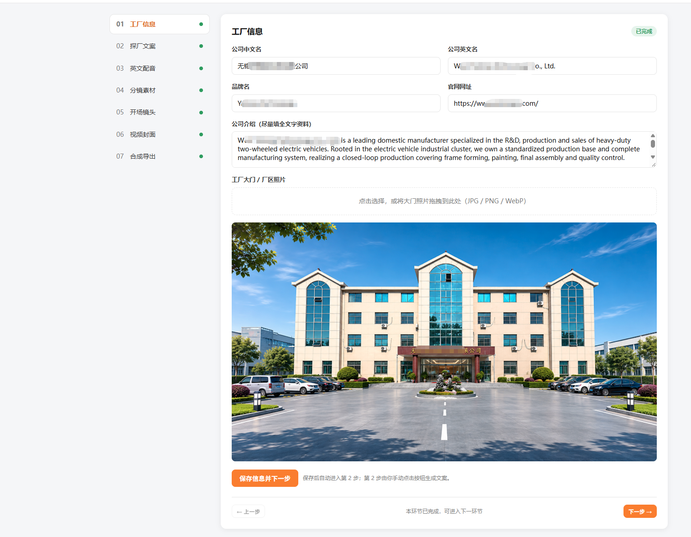
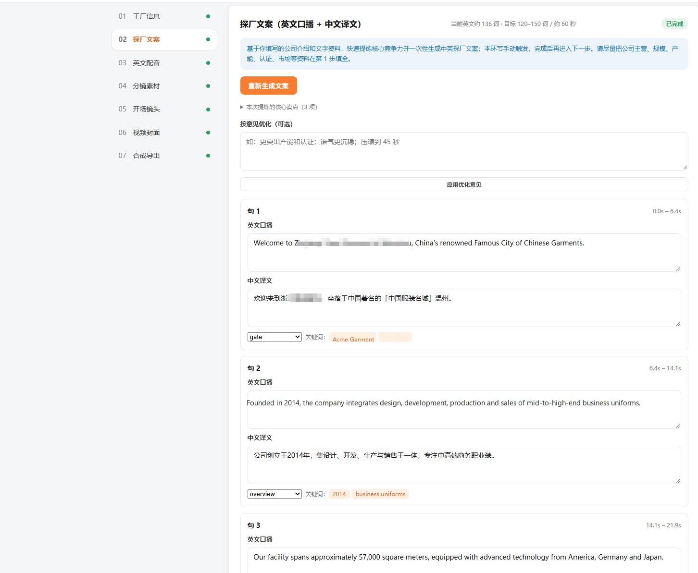
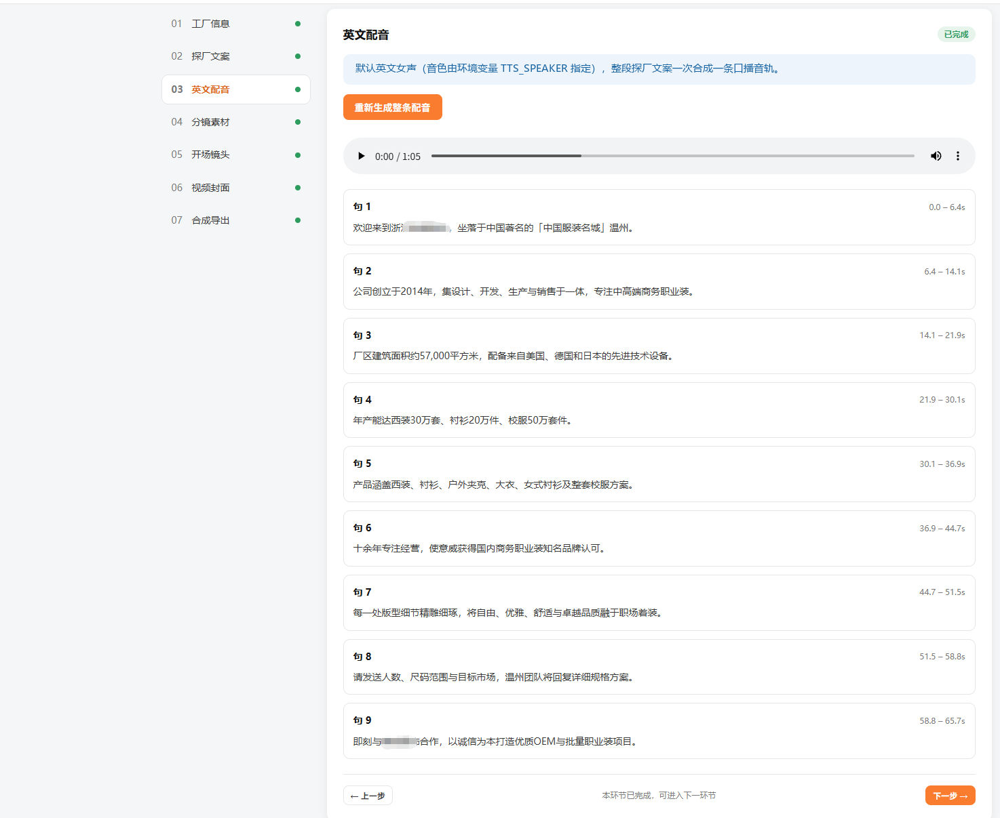
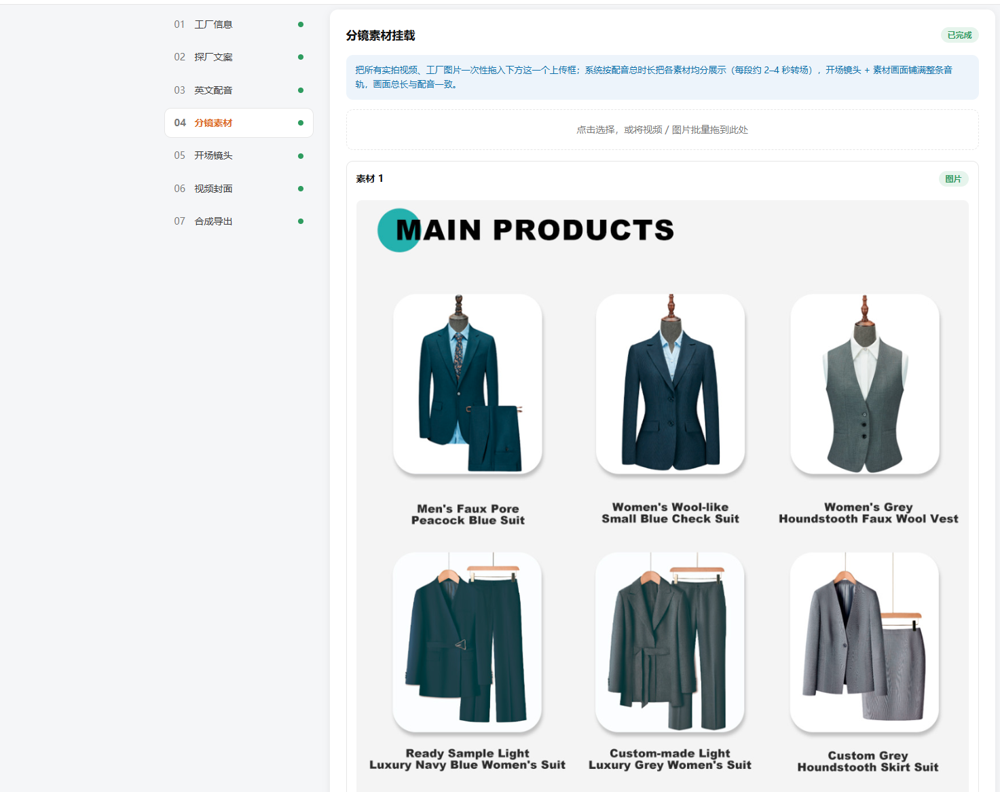
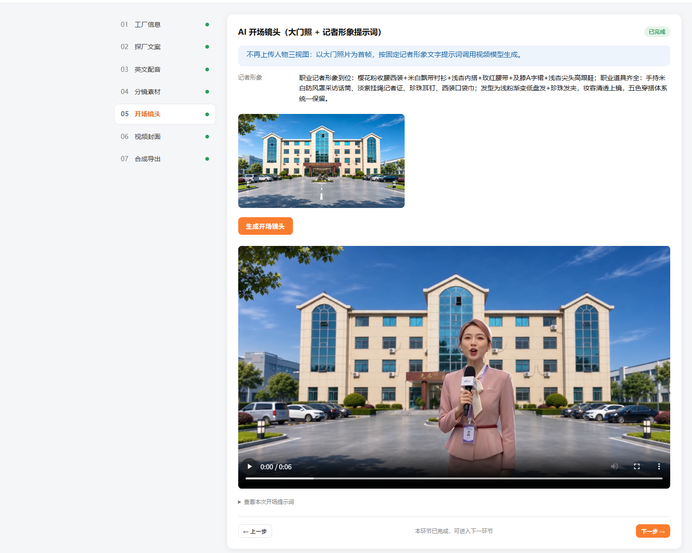
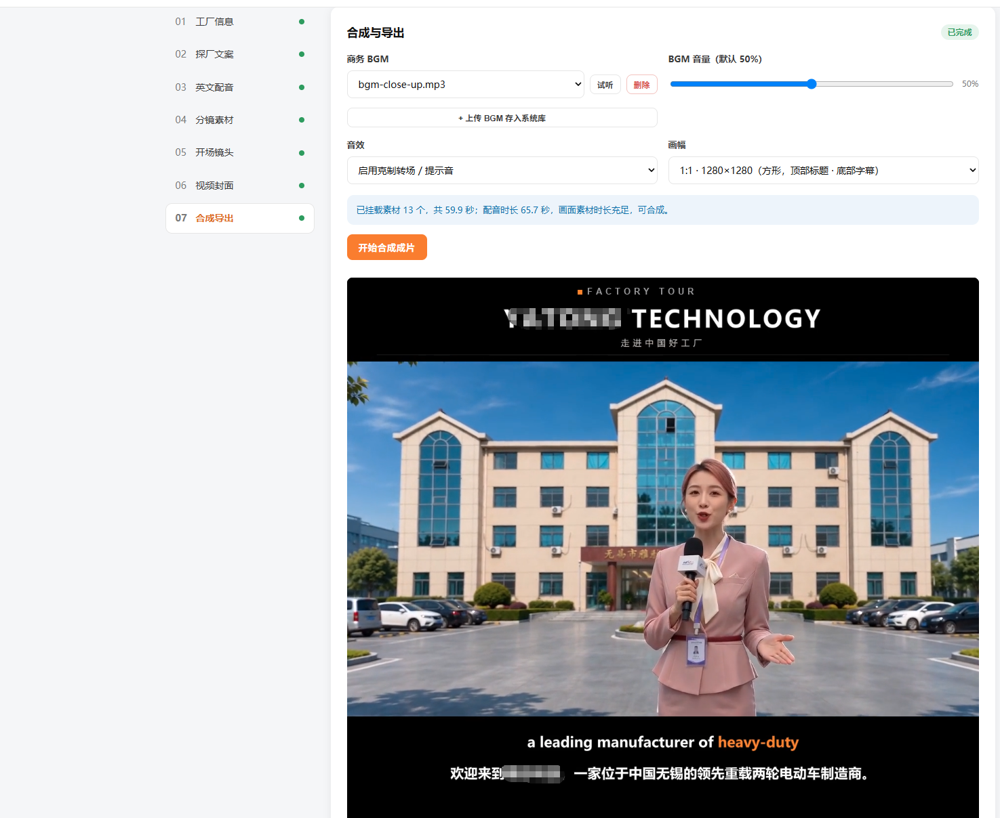

# Factory Tour Video Maker · 探厂短视频工具

一个跑在本机的**英文短视频生产工具**，专为中国工厂的海外内容而做：填一份公司介绍，就能一路产出「**短视频脚本 → 英文口播配音 → 1:1 视频封面 → 记者采访式数字人开场 → 字幕 / 音效 / 素材自动合成导出**」的成片，直接投 TikTok、YouTube Shorts、Instagram Reels、LinkedIn 或发给海外客户。

它把「拍工厂、写脚本、配音、剪片子」这条链上最费时间的部分自动化了，剩下的只需要传素材、点下一步。

**能做什么**

- **短视频脚本策划** —— 一次模型调用完成「核心卖点提炼 + 英文口播稿 + 中文译文」，可以给一句意见整体重写，也可以逐句改
- **口播声音生成** —— 整段文案一次合成一条音轨，按每句英文词数占比自动排时间轴，不必手工对时长
- **视频封面生成** —— 以工厂大门/厂区照为参考图，输出 **1:1 方形封面**，六行版式：栏目徽章 / 品牌大字 / 中文栏目名 / 卖点短句
- **记者采访式数字人探厂视频** —— 大门照作首帧 + 固定「出镜记者」形象提示词，生成 6 秒「开口即讲」的开场镜头，全片风格统一
- **字幕 / 音效 / 素材自动化合成导出** —— 英上中下双字幕（单行不折行）、卖点卡、商务音效族、转场全部由本机 ffmpeg + ASS 生成，一键出片

**技术特点**

- 本地单机、**零 npm 依赖**（`node:http` + 本机 `ffmpeg`/`libass`），不需要数据库、不需要部署
- 前端是无构建的静态页，改样式直接改 CSS
- 所有模型调用都在服务端完成，密钥永不进浏览器
- 字幕是 ASS 硬烧，卖点卡/标题/底板全部用 ASS 矢量绘制（不依赖任何付费字体或模板）

> 成片形态：1280×1280（1:1）或 1280×720（16:9），30fps，H.264 + AAC，约 60 秒，英文口播 + 中英双语字幕。视频封面与成片同比例，1:1。

---

## 界面一览

七个环节，左侧步骤栏会实时显示每个环节的完成状态；下面是一个真实项目的界面截图（公司名与客户信息已打码）。

**01 · 工厂信息** —— 这里填的东西是后续所有环节的唯一事实来源：公司中英文名、品牌、官网、公司介绍，再传一张大门/厂区照。



**02 · 探厂文案** —— 一次调用出「英文口播 + 中文译文 + 关键词」，右上角实时显示当前词数与目标区间；不满意可以写一句意见整体重写，也可以按句改。



**03 · 英文配音** —— 整段文案合成一条音轨，下面按句列出时间轴，方便对着改稿。



**04 · 分镜素材** —— 视频/图片一次性批量拖进来，系统按配音总时长把素材均匀铺开。



**05 · 开场镜头** —— 上传的大门照 + 固定记者形象文字提示词，生成 6 秒开场：记者站在厂门前开口就讲第一句。



**07 · 合成导出** —— 选 BGM、音量、音效、画幅，点开始合成；上方会提示素材总时长与配音时长是否够用。



---

## 它长什么样

```text
┌─────────────────────────────┐   ← 标题区：栏目小标 + 品牌大标题 + 中文栏目名 + 1px 收口线
│  ■ FACTORY TOUR             │
│      YOURBRAND  SINCE 1975  │
│        走进中国好工厂        │
├─────────────────────────────┤
│                             │
│   ┌─────────────────────┐   │   ← 16:9 实拍/开场镜头，居中放置
│   │  ■ 卖点卡（大字重）  │   │      卖点卡落在画面内，开场镜头段不出卡
│   └─────────────────────┘   │
│                             │
├─────────────────────────────┤
│   English caption line      │   ← 英文字幕在上
│   中文字幕（单行，不折行）   │   ← 中文字幕在下，靠近主体下沿
└─────────────────────────────┘
```

---

## 快速开始

```bash
git clone https://github.com/zihengkai/factory-tour-video-maker.git
cd factory-tour-video-maker

node server/setup-audio.mjs     # 下载免费授权的 BGM 与音效母带，并派生商务音效族
node server/server.js           # 打开 http://127.0.0.1:8731
```

环境要求：

- **Node.js ≥ 20**（实测 v22），ESM，**不用 `npm install`**
- **ffmpeg / ffprobe**，需含 `libx264`、`libass`、`aac`
  - Windows：`choco install ffmpeg` 或去 gyan.dev 下 essentials build
  - macOS：`brew install ffmpeg`
  - 不在 PATH 也行，`server/lib/media.js` 会按 `FFMPEG_PATH` → `FFMPEG_DIR` → choco/Program Files/WinGet 顺序自动找
- 可选：`PORT`（默认 8731）、`PROJECTS_ROOT`（默认 `<repo>/projects`）

**只想看效果、不想配模型密钥**：素材上传、时长校验、字幕/卖点卡/音效/转场合成全部是本机能力，不花额度。但文案、配音、开场镜头、封面需要模型，见下一节。

---

## 配置（必读：本仓库不含任何模型与密钥）

所有能力都通过环境变量注入，`server/config.js` 里没有任何真实 key、私有网关或模型名。

| 能力 | 环境变量 | 说明 |
| --- | --- | --- |
| 文案 | `LLM_BASE` `LLM_API_KEY` `LLM_MODEL` | 任意 OpenAI 兼容 `/chat/completions` 服务（支持 `response_format: json_object`） |
| 封面 | `IMAGE_BASE` `IMAGE_API_KEY` `IMAGE_MODEL` | OpenAI 兼容 `/images/edits`（**要能接收 multipart 参考图**）+ `/images/generations` 兜底 |
| 开场镜头 | `VIDEO_BASE` `VIDEO_API_KEY` `VIDEO_MODEL` | 异步任务式视频 API：`POST {base}/contents/generations/tasks` 建任务、`GET {base}/contents/generations/tasks/{id}` 轮询 |
| 配音 | `TTS_ENDPOINT` `TTS_API_KEY` `TTS_MODEL` | 返回 `{audio: base64, duration}` 的语音合成接口 |
| 栏目名 | `TOUR_PROGRAM` `TOUR_PROGRAM_ZH` `TOUR_COVER_ZH` `TOUR_COLUMN` | 成片标题、封面徽章、提示词里的栏目名（默认 `FACTORY TOUR` / `走进中国好工厂`） |

PowerShell 示例：

```powershell
$env:LLM_BASE="https://your-llm-api.example.com/v1"
$env:LLM_API_KEY="your-llm-key"
$env:LLM_MODEL="your-llm-model"

$env:IMAGE_BASE="https://your-image-api.example.com/v1"
$env:IMAGE_API_KEY="your-image-key"
$env:IMAGE_MODEL="your-image-model"

$env:VIDEO_BASE="https://your-video-api.example.com/v1"
$env:VIDEO_API_KEY="your-video-key"
$env:VIDEO_MODEL="your-video-model-id"

$env:TTS_ENDPOINT="https://your-tts-api.example.com/v1/tts"
$env:TTS_API_KEY="your-tts-key"
$env:TTS_MODEL="your-tts-model"
$env:TTS_SPEAKER="your-voice-id"    # 可选

node server/server.js
```

启动时会把未配置的能力打印出来，例如 `开场镜头（缺 VIDEO_BASE / VIDEO_API_KEY / VIDEO_MODEL）`——不影响其他环节。

> 换不同厂商的接口时，只需改 `server/lib/{llm,image,video,tts}.js` 里的请求体，接口契约在文件顶部注释里写清了。

---

## 工作流（7 步，第 2 步起手动触发）

| 步骤 | 做什么 | 产物 |
| --- | --- | --- |
| 1 · 工厂信息 | 填公司中英文名、品牌、官网、**公司介绍**（文案唯一事实来源）、传大门/厂区照 | `company` + `uploads/` |
| 2 · 探厂文案 | 一次模型调用完成「卖点提炼 + 英文口播稿 + 中文译文」，可二次优化、可逐句改 | `script.sentences[]` |
| 3 · 英文配音 | 整段文案一次合成一条音轨，按各句**英文词数占比**分摊时间轴 | `audio/voice.mp3` |
| 4 · 分镜素材 | 批量拖入视频/图片，**按原始完整时长使用一遍**（不裁剪、不循环复用） | `assets[]` |
| 5 · 开场镜头 | 大门照作首帧 + 固定记者形象文字提示词，生成 6s 开场 | `ai/opening.mp4` |
| 6 · 视频封面 | 大门照作参考图，1:1 / 1024×1024，六行版式，只生成一张 | `ai/cover-1.png` |
| 7 · 合成导出 | 选 BGM、音量、音效、画幅 → 本机 ffmpeg 合成 | `export/final.mp4` 等 |

**素材时长硬校验**：素材总时长不足「配音时长 − 开场段」时，第 4 步会提示缺口、第 7 步会直接拦截，不会合出一条尾巴空白的片子。

---

## 目录结构

```text
factory-tour-video-maker/
├── package.json                 # 零依赖，只有 start / setup-audio / check
├── server/
│   ├── config.js                # 全部走环境变量，无任何真实密钥
│   ├── server.js                # HTTP 路由 + 单项目串行异步任务
│   ├── setup-audio.mjs          # 下载免费 BGM/音效母带 + ffmpeg 派生商务音效族
│   └── lib/
│       ├── store.js             # 项目目录 / project.json 状态真源
│       ├── llm.js               # 卖点提炼 + 口播稿（OpenAI 兼容）
│       ├── tts.js               # 整段配音 + 词数分摊时间轴
│       ├── image.js             # 封面：参考图编辑（multipart 多图）+ 文生图兜底
│       ├── video.js             # 开场镜头：异步建任务 + 轮询 + 下载
│       ├── render.js            # 归一化 → xfade → 混音 → ASS 烧字幕 → final.mp4
│       └── media.js             # ffmpeg/ffprobe 定位与封装
├── public/                      # 无构建静态前端
│   ├── index.html  css/styles.css  js/app.js
├── docs/images/                 # README 用的界面截图（已打码）
├── assets/audio/
│   ├── bgm/                     # 11 首商务 BGM（脚本下载，不入库）
│   ├── sfx/                     # 10 支商务音效（脚本下载+派生，不入库）
│   └── CREDITS.md               # 授权与来源（脚本生成）
└── projects/                    # 运行时生成，每个项目一个目录（不入库）
```

单个项目目录：

```text
projects/<projectId>/
├── project.json     状态真源（含 settings / stages / 时间轴）
├── uploads/         大门照
├── assets/          分镜素材
├── audio/voice.mp3  配音
├── ai/              opening.mp4 / cover-1.png
└── export/          final.mp4 / silent.mp4 / subs.ass / script.md / script.csv / cover.png
```

---

## 关键实现与规则（改代码前先读这一节）

### 1:1 版式（1280×1280）

| 区块 | 参数 |
| --- | --- |
| 标题区 | 0–170；栏目小标 19px `#9BA1AB` + 7×7 橙方块（整体簇宽居中，`y=22/26`）；品牌 64px 粗体 `y=50` + 内联 `SINCE 年份` 橙；中文栏目名 23px `#B9BEC7` `y=120`；1px 收口线 `#262A31` `y=156` |
| 视频主体 | 16:9 源等比缩到 1280×720，`y=170–890`，上下黑底 |
| 卖点卡 | `cardTop=182`、`plateX=24`、`textX=55`、高 64、5×48 橙条、40px 粗体；`\move(x-26→x, 0→220ms)` + `fad(160,200)` |
| 字幕 | 英文 38px / `MarginV=320`；中文 36px / `MarginV=258`；都在主体下方、不贴底 |
| 16:9 版 | 英 32px `MarginV 72`、中 28px `MarginV 34`、卡片 34px，不叠加标题层 |

### 字幕分段（永远单行）

- 上限：英文 58（1:1）/ 52（16:9）字符，中文 32 字符
- 先按标点切（`, ， ; ； 、 ·`，数字千分位逗号不算断点）→ 仍超长按靠近中点的空格切 → 中文无空格则对半切
- 段尾若是 `a/the/of/to/in/and...` 这类弱词，搬到下一段，避免断读
- 中英各自独立分段、各自按字数占比分配该句时长（**不要**强行让中英段数相等，会把中文词切碎）
- 首段 +0.12s 切入，不要 0 秒就压字

### 卖点卡

- 取句子 `keywords` 前 2 个，`主词白 + 点分隔灰 + 次词橙`
- 开场镜头段（第 1 句）不出卡；每卡延后 0.15s、最长停留 6s；一屏一张

### 音效（商务宣传片感，不要叮咚金币声）

- 三族随机：`cut`（切点）/ `card`（卡片入场）/ `payoff`（收尾，全片一次）
- 同一族内**真随机**取一支，并避开最近 3 秒内刚响过的；切点音与卡片音互相避让（±700ms），全局至少隔 1.6s
- **每支音效输入只播一次**（绝不能用 `-stream_loop -1`，否则一条音墙铺满全片）
- 增益按素材实测峰值反算（`npm run setup-audio` 会打印建议值），末级 `alimiter=limit=0.84` 防削顶

### 转场

- 开场 → 第一段：`fadeblack` 0.26s；素材之间 `fade` 0.18s
- 素材余量不够时自动退回硬切，保证成片时长不被转场吃掉

### 上传

- 文件名走 URL 查询参数 `?filename=`（**不要**放请求头，中文名会触发 `non ISO-8859-1 code point`）
- 单文件上限 200MB；落盘名 `slot-randomhex.ext`

---

## API

| 方法 | 路径 | 作用 |
| --- | --- | --- |
| GET | `/api/config` | 记者形象 / 输出规格 / 音色（不含密钥） |
| GET·POST | `/api/projects` | 列表 / 新建 |
| GET·PUT·DELETE | `/api/projects/:id` | 读 / 改（含草稿）/ 删 |
| POST | `/:id/script` | 生成或按意见优化文案 |
| PUT | `/:id/script/sentence/:sid` | 单句编辑 |
| POST | `/:id/tts` | 配音 + 时间轴 |
| POST | `/:id/opening` · GET `/:id/opening/poll` | 开场镜头建任务 / 轮询 |
| POST | `/:id/cover` · `/:id/cover/select` | 封面生成 / 选择 |
| GET | `/:id/render/check` | 素材 vs 配音时长对比 |
| POST | `/:id/render` | 合成 |
| POST | `/:id/upload/:slot` · `/:id/upload/remove` | 素材上传 / 移除 |
| GET | `/:id/job` · `/:id/file/*` | 任务状态 / 项目文件 |
| GET | `/api/assets/sfx` | 音效列表 |
| GET·POST·DELETE | `/api/assets/bgm(/:name)` | BGM 列表 / 试听 / 上传 / 删除 |

---

## 常见坑（都是真踩过的）

| 现象 | 原因 | 解法 |
| --- | --- | --- |
| 卡片底板/橙条不显示 | 部分 libass 版本不渲染 `BorderStyle 3` 的 BackColour | 用 `\p1` 矢量绘制矩形 |
| `subtitles` 滤镜报解析错误 | Windows 绝对路径的盘符冒号被当选项分隔 | `cwd` 设项目目录 + 相对路径 `subtitles=export/subs.ass` |
| 上传中文文件名报 `non ISO-8859-1 code point` | 文件名塞进了请求头 | 改走 `?filename=` 查询参数 |
| 封面不像自己厂门 | 落到了 `generations` 兜底（该端点不收参考图） | 确认 `images/edits` 可用（multipart `image[]`） |
| 大图参考「没生效」 | base64 过大被代理层截断 | 先 ffmpeg 缩到长边 1024 转 JPEG 再 base64 |
| 音效全程同一个声音、特别密 | 音效输入用了 `-stream_loop -1` | 改普通 `-i`，一处一次，同文件多处用 `asplit` |
| 量峰值量不准 | `astats` 首条读的是首帧 | 用 `volumedetect` 的 `max_volume` |
| 短窗口测不出音效 | `-ss` 窗口太短、采样不足 | 单独渲染「仅音效轨」或逐帧 RMS |

---

## 素材授权

- BGM / 音效母带来自 [Mixkit](https://mixkit.co)，Mixkit Stock Music Free License / Sound Effects Free License，**可商用、免署名**；派生变体是本机 ffmpeg 处理，无新增第三方素材。运行 `npm run setup-audio` 会在 `assets/CREDITS.md` 生成清单。
- 用户自行上传的实拍图片/视频版权归上传者所有。
- 代码 MIT，见 [LICENSE](LICENSE)。

---

## Roadmap

- [ ] 真实词级时间戳（现在按词数估算，长句有 ~0.3s 漂移）
- [ ] 多语言配音与字幕（当前英文口播 + 中英双语字幕）
- [ ] 口型对齐（当前由视频模型自行推断）
- [ ] Web 端素材自动排序建议

---

## License

MIT © 2026 zihengkai
